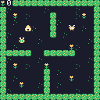

# Chili Beat

A tiny no-code game engine for the web and the chilichip console.
Things bump, move and change on the beat.



- Plan and milestones: [#1](https://github.com/chili-chip/chili-beat/issues/1)
- Docs: [`docs/`](docs) (MkDocs). Start with [`docs/index.md`](docs/index.md)
- File format: [`format/schema.json`](format/schema.json), explained in [`docs/format.md`](docs/format.md)
- Example games: [`tests/data/`](tests/data)

## Quickstart

You need CMake 3.20+, a C++20 compiler and Python 3. Paths below assume this
repo sits next to `32blit-sdk` and `pico-sdk`, as in the chili-chip workspace.

### 1. Build the engine and run the tests

```bash
cmake -S . -B build
cmake --build build -j
ctest --test-dir build --output-on-failure
```

### 2. Take a screenshot of a game

`beat-shot` plays a game with button presses and saves the screen:

```bash
./build/beat-shot tests/data/bee-home.beat shot.png "2 up right" --scale 4
```

Words: `up down left right a b` (press and release), `wait` (1/60 s),
`beat` (until the next beat), and a number before a word repeats it.

### 3. Play on the desktop (32blit SDL player)

Needs SDL2 and the 32blit tools (`pip install 32blit "bitstring<5"`).

```bash
cmake -S hosts/32blit -B build-sdl -D32BLIT_DIR=$PWD/../32blit-sdk
cmake --build build-sdl -j
./build-sdl/chili-beat --launch_path ../tests/data/bee-home.beat
```

The launch path is relative to `build-sdl/`, not to where you run it from.
Arrows move, Z is A, X is B. Try the other games in `tests/data/`.

### 4. Play in the browser (wasm player)

Needs [Emscripten](https://emscripten.org/docs/getting_started/downloads.html) and Node.

```bash
emcmake cmake -S hosts/wasm -B build-wasm -DCMAKE_BUILD_TYPE=Release
cmake --build build-wasm -j
node hosts/wasm/test.mjs build-wasm    # plays Bee Home to a win
python -m http.server -d build-wasm    # open http://localhost:8000
```

The page plays Bee Home. Pick any `.beat` file to play it instead.

### 5. Play on the console

Build the `.blit` (needs `gcc-arm-none-eabi` and the Pico SDK):

```bash
cmake -S hosts/32blit -B build-vgc \
  -D32BLIT_DIR=$PWD/../32blit-sdk -DPICO_SDK_PATH=$PWD/../pico-sdk \
  -DPICO_BOARD=chilichip_vgc -DPICO_PLATFORM=rp2350-arm-s \
  -DCMAKE_TOOLCHAIN_FILE=$PWD/../32blit-sdk/pico2.toolchain \
  -DBLIT_EXECUTABLE_PICO_BLIT=1 -DCMAKE_BUILD_TYPE=Release
cmake --build build-vgc -j
```

Copy `build-vgc/chili-beat.blit` and some `.beat` files onto the CHILICHIP
drive. The games show up on the home screen.

### 6. Make your own game

Copy `tests/data/blank.beat`, edit it, then check it:

```bash
python -m venv .venv && . .venv/bin/activate
pip install -r requirements-docs.txt
python format/validate.py my-game.beat
```

The engine gives exact errors too, for example
`rules[1].do[0].become: no thing has key "z"`. Rules are explained in
[`docs/rules.md`](docs/rules.md).

### 7. Read the docs

```bash
mkdocs serve    # http://127.0.0.1:8000
```
