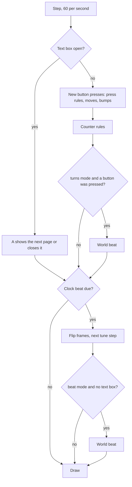

# How a beat runs

This page is the exact behaviour of the engine. The editor, the tests and every
player follow it. If the code and this page disagree, one of them is a bug.

## Clock

The engine steps 60 times a second. All maths is whole numbers, and random
numbers come from one seeded generator, so the same file, seed and buttons
always give the same game.

There are two kinds of beat:

| Beat | When | What it does |
|------|------|--------------|
| **Clock beat** | `tempo` times a second, in both modes | Flips 2-frame pictures, plays the next tune step, ends a shake. |
| **World beat** | On every clock beat in `beat` mode. After each button press in `turns` mode. | Runs beat rules. Counts toward "every N beats". |

## A world beat

1. The beat number goes up by 1. It starts at 0 when the game starts.
2. The engine lists all things on the screen, from top-left to bottom-right.
   Things made during this beat are not on the list. They wait for the next one.
3. For each thing on the list that still exists, every beat rule is checked from
   top to bottom. A rule runs for the thing when the thing matches and the beat
   number divides by `every`.
4. Counter rules run (see below).

During a world beat, each thing moves at most once. A second move on the same
thing in the same beat does nothing.

## Pressing a button

On each step, new presses are handled in this order: A, B, up, down, left, right.
For each one, every press rule that matches runs. "Arrow" matches all four
arrows. Holding a button does not repeat it.

## Moving and bumping

When a thing tries to move one cell:

1. It turns to face that way, even if it can't move.
2. If the cell is outside the board:
    - if the thing is *you* and there is a screen next to this one on the map,
      it walks to that screen (see [Screens](#screens));
    - otherwise it stays. Nothing is bumped.
3. If the cell is empty, the thing moves there.
4. If the cell is full, the thing **bumps** what is there:
    1. Every bump rule that matches (bumper, bumped) runs, top to bottom.
    2. Then, if the bumper is still in its old cell and the target cell is now
       empty, the bumper moves in.
    3. Otherwise the bumper stays.

With no matching bump rule, step 4.1 does nothing, so the cell acts as a wall.

Bumps can cause more moves and more bumps, for example a row of crates. A chain
stops after 16 bumps. The 17th move in a chain is blocked.

In rules, a thing is in its new cell straight away. On screen it slides there
over a quarter of a beat.

## Ways

`toward` finds the nearest other *you* thing by steps (left/right plus up/down).
If two are as near, the first one from the top-left wins. The thing steps along
the longer side of the gap. If both sides are the same, it steps left or right.
With no other *you* thing, nothing happens. `away` is the opposite step.

`random` picks up, right, down or left with the same chance.

## Counters

Counters stay between 0 and 999. Adding past a limit stops at the limit.

"When Counter reaches N" runs when the counter's value is N and was something
else the last time counter rules were checked. Counter rules are checked after
start rules, after button presses and after each world beat. If counter rules
change counters, they are checked again, up to 16 times.

## Screens

Each screen keeps its own board. When you leave a screen and come back, it is as
you left it, unless the screen has `reset`.

*You* things belong to the screen you are on:

- When you **leave** a screen, all *you* things are taken off it.
- When you **walk** onto a screen, only the thing that walked arrives. It enters
  on the far edge, in the same row or column. If that cell is full, it can't go,
  and nothing changes. *You* things drawn on that screen's map are not placed.
- When the game **starts** or a rule says **go**, the *you* things are placed
  where the screen's map draws them.

Entering a screen runs its start rules, then counter rules.

A **go** or a walk to another screen happens after the current card's actions
finish. Only one screen change happens per step.

## Text, winning and losing

**Say** queues a text box. While a text box is open, the world stops: no presses
and no world beats. Clock beats still flip frames and play music. The box holds
3 lines of 20 characters, and long text is split at spaces into pages. A shows
the next page, and closes the box after the last one.

**Win** and **lose** show their text in the same box (or "You win!" and
"You lose." when the text is empty). The rest of the card's actions still run,
but no more rules start. Pressing A starts the game again from the beginning,
with the same seed.

## Shake

The board shakes by one pixel for one clock beat.

## Drawing

The engine draws a 128 × 128 picture of colour numbers 0 to 3. The player turns
them into real colours from the game's palette.

1. Fill with colour 0.
2. Draw the ground.
3. Draw the things. A thing that just moved slides from its old cell.
4. Draw the counters over the top-left corner: the icon, then the number in
   colour 3, on a colour 0 strip.
5. Draw the text box, if one is open, near the bottom: colour 0 box, colour 3
   border and text.
