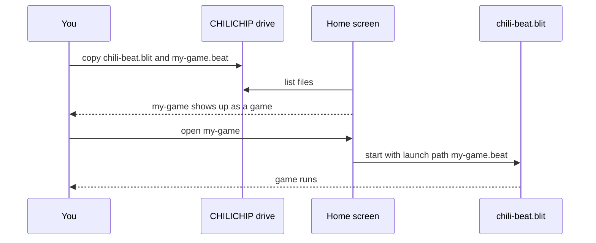

# Console player

On the chilichip console, Chili Beat is a **handler app**: a `.blit` that opens
one kind of file. The console's home screen lists every `.beat` file on its
drive as a game, and opens it with Chili Beat. No change to the console's
system was needed.



## Install

1. Get `chili-beat.blit` from a [release](https://github.com/chili-chip/chili-beat/releases)
   (or the `chili-beat-blit` artifact of the "Build players" CI run).
2. Connect the console by USB. It shows up as a drive called **CHILICHIP**.
3. Copy `chili-beat.blit` onto the drive. The console installs it.
4. Copy your `.beat` games onto the drive.
5. Eject the drive. Your games are on the home screen.

Games made on the Chili Platform reach the console through device sync, as
`.beat` files.

## Buttons

| Console | Game |
|---------|------|
| D-pad | Arrows |
| A | A |
| B | B |
| MENU | The console's system menu, where you can leave the game |

## What it does

- Reads the `.beat` file the home screen passes in, and shows the load error if
  the file is broken.
- Draws the 128 × 128 screen as large as fits, in the middle.
- Plays the 4 sound channels on the console's synth (square, triangle and noise).
- Started with no file, for example on a desktop build, it plays Bee Home.

## Build it

You need the [32blit SDK](https://github.com/chili-chip/32blit-sdk) next to this
repo, the 32blit tools (`pip install 32blit`) and, for the console, the
[Pico SDK](https://github.com/chili-chip/pico-sdk) and an ARM GCC.

=== "Desktop (SDL)"

    ```bash
    cmake -S hosts/32blit -B build-sdl -D32BLIT_DIR=../32blit-sdk
    cmake --build build-sdl
    ./build-sdl/chili-beat --launch_path tests/data/garden-toy.beat
    ```

=== "Console (.blit)"

    ```bash
    cmake -S hosts/32blit -B build-vgc \
      -D32BLIT_DIR=../32blit-sdk -DPICO_SDK_PATH=../pico-sdk \
      -DPICO_BOARD=chilichip_vgc -DPICO_PLATFORM=rp2350-arm-s \
      -DCMAKE_TOOLCHAIN_FILE=../32blit-sdk/pico2.toolchain \
      -DBLIT_EXECUTABLE_PICO_BLIT=1 -DCMAKE_BUILD_TYPE=Release
    cmake --build build-vgc
    ```

`metadata.yml` marks the app as `category: handler` with `filetypes: beat`.

## Memory

The console has little memory, so the engine keeps only the screen you are on
as full things. Screens you have left are kept as one byte of kind and one byte
of facing per cell (about 0.5 KB each, 32 KB for 64 screens).
