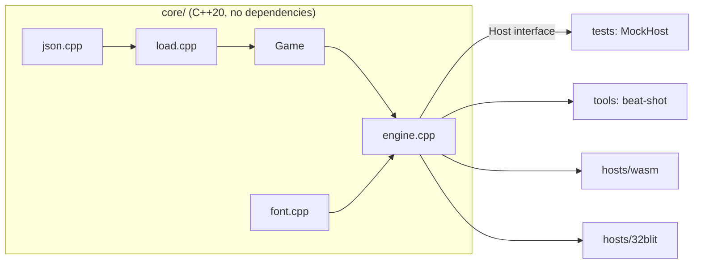

# Building and testing

## Repo layout

| Path | What |
|------|------|
| `core/include/chili_beat/` | Public headers: `game.hpp` (data), `engine.hpp`, `host.hpp`. |
| `core/src/` | The engine: JSON reader, loader, engine, font. No platform code. |
| `tests/` | Unit and game tests, with a tiny test runner. |
| `tests/data/*.beat` | Example and test games. |
| `tools/beat_shot.cpp` | Plays a game and saves a PNG. |
| `hosts/wasm/` | Web player: C API, `player.js`, demo page, Node test. See [Web player](web.md). |
| `hosts/32blit/` | Console player (handler `.blit`). See [Console player](console.md). |
| `format/schema.json` | The file format, as JSON Schema. |
| `format/validate.py` | Checks `.beat` files against the schema. |
| `docs/` | This site (MkDocs). |



## Build and run the tests

You need CMake 3.20+ and a C++20 compiler.

```bash
cmake -S . -B build
cmake --build build
ctest --test-dir build --output-on-failure
```

Run only some tests by name:

```bash
./build/chili_beat_tests bump
```

The test runner is `tests/check.hpp`. A test looks like this:

```cpp
TEST(arrows_move_you) {
  Engine e(helpers::fixture("blank.beat"));
  play(e, "right");
  CHECK_EQ(find(e, '@'), cell(8, 7));
}
```

`play()` runs an input script, the same words `beat-shot` takes (below).

## Screenshots

`beat-shot` plays a game with an input script and saves the screen:

```bash
./build/beat-shot tests/data/bee-home.beat bee.png "3 right 2 up 4 beat" --scale 4
```

| Word | Does |
|------|------|
| `up` `down` `left` `right` `a` `b` | Press the button for one step, then let go for one step. |
| `wait` | Wait one step (1/60 s). |
| `beat` | Wait until the next world beat. |
| `N word` | Do `word` N times. |

The pictures on these pages come from it:

```bash
for g in blank bee-home crate-puzzle garden-toy every-action; do
  ./build/beat-shot tests/data/$g.beat docs/assets/shots/$g.png
done
```

## Check the example games

```bash
python -m venv .venv
. .venv/bin/activate
pip install -r requirements-docs.txt
python format/validate.py tests/data/*.beat
```

## Build the docs

```bash
mkdocs serve          # live preview at http://127.0.0.1:8000
mkdocs build --strict # what CI runs
```

## CI

`.github/workflows/ci.yml` runs on every pull request and on `main`:

- builds the core and runs the tests (with address and undefined-behaviour checks),
- checks the example games against the schema,
- builds the docs with `--strict`.

`.github/workflows/build.yml` builds the players:

- the web player with Emscripten, then plays Bee Home to a win in Node,
- the 32blit player for Linux, and the `.blit` for the console (checked to be an RP2350 build).

When a GitHub release is published, it attaches `chili-beat.js`, `chili-beat.wasm`,
`player.js` and `chili-beat.blit` to the release.
