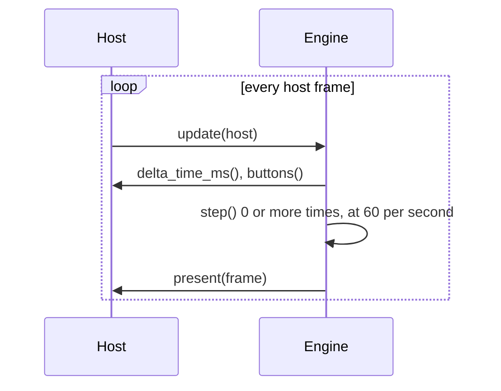

# Engine API

This page is for people writing a player (a *host*) for Chili Beat. The web and
console players use the same API.

## Load a game

```cpp
#include <chili_beat/engine.hpp>

chili_beat::Game game;
std::string error;
if (!chili_beat::load(text, game, error)) {
  show(error);  // for example: "rules[1].do[0].become: no thing has key \"z\""
  return;
}
chili_beat::Engine engine(std::move(game));
```

`load` never throws. Errors name the place in the file, so the editor can point at it.

## Run it

The host gives the engine time and buttons, and gets frames back:

```cpp
class MyHost : public chili_beat::Host {
  uint32_t delta_time_ms() override;           // ms since the last call
  uint8_t buttons() override;                  // kUp | kDown | kLeft | kRight | kA | kB
  void present(const chili_beat::Frame&) override;
};

// Every frame of the host:
engine.update(host);  // calls host.present(frame) with pixels and sound
```



`update` runs fixed steps of 1/60 s, so the game runs the same at any host frame
rate. After a long pause it catches up at most a quarter second.

Tests and tools can skip the host and call `step(buttons)` and `draw(frame)` directly.

## What the engine tells you

| Call | Gives |
|------|-------|
| `state()` | `Playing`, `Won` or `Lost`. |
| `text()` | The open text box page, lines split by `\n`, or empty. |
| `counter(i)` | Value of counter `i`. |
| `screen()` | Index of the screen you are on. |
| `beat()` | World beats since the start. |
| `fired()` | Indexes of the rules that ran during the last step, in order. The creator lights these cards up. |
| `sounds()` | Blips started during the last step. |
| `board()` | The 256 cells of the screen, each empty or a `Thing` (kind, facing, id). |

## Frames

A `Frame` is 128 × 128 colour numbers, 0 to 3, row by row. Turn them into real
colours like this:

```cpp
uint32_t rgb = chili_beat::kSweetie16[game.palette[frame.pixels[y * 128 + x]]];
```

## Sound

`frame.channels` holds 4 channels: tune lead, tune beat and two blips. Set your
synth to them on every frame. See [Sound](sound.md#what-the-engine-sends-to-the-player).

## Buttons

| Button | Console | Keyboard (suggested) |
|--------|---------|----------------------|
| `kUp` `kDown` `kLeft` `kRight` | D-pad | Arrow keys, WASD |
| `kA` | A | Z, Space, Enter |
| `kB` | B | X |
