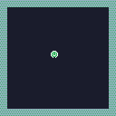
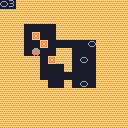
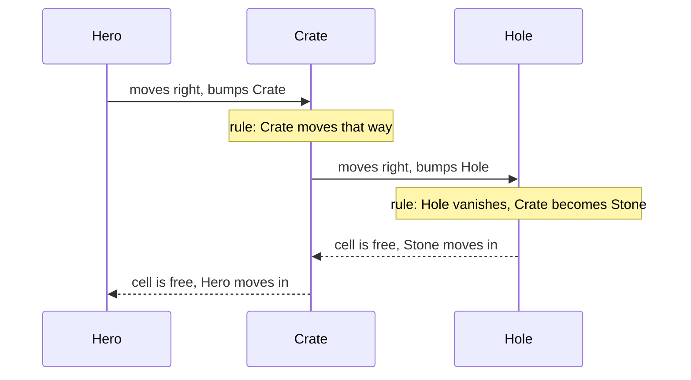
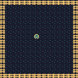
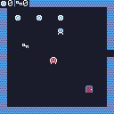

# Example games

These games live in [`tests/data/`](https://github.com/chili-chip/chili-beat/tree/main/tests/data).
They are the editor's templates and the engine's test games at the same time.
The pictures are real screens, drawn by the engine with `beat-shot` (see
[Building and testing](develop.md#screenshots)).

| Game | File | Shows |
|------|------|-------|
| [Blank](#blank) | `blank.beat` | The smallest game: one hero, walls, one rule. |
| [Bee Home](#bee-home) | `bee-home.beat` | Pick-ups that grow back, a chaser, win and lose. |
| [Crate Puzzle](#crate-puzzle) | `crate-puzzle.beat` | Turns, pushing, a counter that ends the game. |
| [Garden Toy](#garden-toy) | `garden-toy.beat` | Chance, making things, a toy with no ending. |
| [Every Action](#every-action) | `every-action.beat` | Every trigger, condition and action at least once. |

## Blank

{ .pixel }

A hero in a walled room. Every new game starts here.

<b class="w">WHEN</b> you press an arrow <b class="t">THEN</b> you move that way

## Bee Home

{ .pixel }

Collect 5 pollen and bring it home. Flowers you visit turn into buds and grow
back after 8 beats. A wasp chases you every 2 beats. The hedges have no rules,
so they act as walls.

<b class="w">WHEN</b> you press an arrow <b class="t">THEN</b> you move that way
<b class="w">WHEN</b> Bee bumps Flower <b class="t">THEN</b> Flower becomes Bud · Pollen up 1 · play coin
<b class="w">WHEN</b> every 8 beats, Bud <b class="t">THEN</b> becomes Flower
<b class="w">WHEN</b> every 2 beats, Wasp <b class="t">THEN</b> moves toward you
<b class="w">WHEN</b> Wasp bumps Bee <b class="t">THEN</b> shake · you lose "Stung! Try again."
<b class="w">WHEN</b> Bee bumps Hive <b class="i">IF</b> Pollen at least 5 <b class="t">THEN</b> you win "The hive is happy."
<b class="w">WHEN</b> Bee bumps Hive <b class="i">IF</b> Pollen at most 4 <b class="t">THEN</b> say "Bring me 5 pollen."

Note that bumping a flower does not move the bee into its cell: the flower
becomes a bud and stays. That is why the bee "visits" flowers instead of eating them.

## Crate Puzzle

{ .pixel }

Push the three crates into the three holes. It plays in **turns**: nothing
happens until you move.

<b class="w">WHEN</b> you press an arrow <b class="t">THEN</b> you move that way
<b class="w">WHEN</b> you bump Crate <b class="t">THEN</b> Crate moves that way
<b class="w">WHEN</b> you bump Stone <b class="t">THEN</b> Stone moves that way
<b class="w">WHEN</b> Crate bumps Hole <b class="t">THEN</b> Hole vanishes · Crate becomes Stone · Holes down 1 · play fill
<b class="w">WHEN</b> Holes reaches 0 <b class="t">THEN</b> you win "All holes filled!"

How a push works, step by step:

## Garden Toy

{ .pixel }

Press A to plant a seed in front of you. Seeds grow into sprouts and then into
flowers, each step a 1 in 3 chance every 4 beats. There is no win and no lose.

<b class="w">WHEN</b> you press an arrow <b class="t">THEN</b> you move that way
<b class="w">WHEN</b> you press A <b class="t">THEN</b> you make Seed forward · play plant
<b class="w">WHEN</b> every 4 beats, Seed <b class="i">IF</b> 1 in 3 chance <b class="t">THEN</b> becomes Sprout
<b class="w">WHEN</b> every 4 beats, Sprout <b class="i">IF</b> 1 in 3 chance <b class="t">THEN</b> becomes Flower
<b class="w">WHEN</b> you bump Flower <b class="t">THEN</b> say "What a lovely flower."

## Every Action

{ .pixel }

Not a real game. It uses every trigger, condition and action, two screens, two
counters and two *you* kinds, so the engine tests can cover everything with one
file. Collect 3 coins to be sent to the second screen, then reach the exit.
