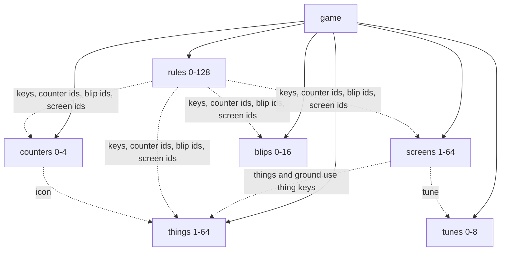

# File format v1

A Chili Beat game is one JSON file with the `.beat` extension. JSON is easy to
read, easy to diff, and fits the platform, which stores games as text.

The formal definition is [`format/schema.json`](https://github.com/chili-chip/chili-beat/blob/main/format/schema.json)
(JSON Schema, draft 2020-12). This page explains every field.

!!! tip "Check a file"
    ```bash
    pip install -r requirements-docs.txt
    python format/validate.py my-game.beat
    ```

## Overview



A short game looks like this (pictures and maps shortened):

```json
{
  "format": "chili-beat",
  "version": 1,
  "title": "Bee Home",
  "palette": [0, 6, 4, 12],
  "tempo": 4,
  "time": "beat",
  "start": "meadow",
  "counters": [{ "id": "pollen", "name": "Pollen", "icon": "f", "start": 0 }],
  "things": [{ "key": "b", "name": "Bee", "you": true, "frames": [["03300330", "…"]] }],
  "screens": [{ "id": "meadow", "map": [0, 0], "tune": "main", "things": ["################", "…"] }],
  "rules": [
    { "when": { "press": "arrow" }, "do": [{ "move": "same" }] },
    { "when": { "bump": ["b", "f"] },
      "do": [{ "become": "u", "who": "bumped" }, { "count": "pollen", "add": 1 }, { "sound": "coin" }] }
  ],
  "blips": [{ "id": "coin", "preset": "coin", "pitch": 5, "length": 2, "slide": 3 }],
  "tunes": [{ "id": "main", "scale": "pentatonic-major", "lead": [1, 0, 3, "…"], "beat": [8, 0, 1, "…"] }]
}
```

## Names used on this page

| Name | Form | Example |
|------|------|---------|
| **id** | 1 to 16 characters: `a`-`z`, `0`-`9`, `-` | `"meadow"`, `"coin"`, `"pollen"` |
| **key** | One printable ASCII character, not `.` and not a space | `"b"`, `"#"`, `"@"` |
| **way** | A direction word, see [Ways](#ways) | `"up"`, `"same"`, `"toward"` |
| **who** | Which thing an action changes, see [Who](#who) | `"bumped"` |

## Top level

| Field | Type | Required | Meaning |
|-------|------|----------|---------|
| `format` | `"chili-beat"` | yes | Marks the file as a Chili Beat game. |
| `version` | `1` | yes | Format version. |
| `title` | text, 1-32 | yes | Game title. |
| `author` | text, 0-32 | no | Who made it. |
| `palette` | 4 numbers, 0-15 | yes | The game's 4 colours, as indexes into [Sweetie 16](palette.md). The first one is the background. |
| `tempo` | 2-8 | yes | Beats per second. |
| `time` | `"beat"` or `"turns"` | yes | `beat`: the world moves on every beat. `turns`: the world moves one beat after each button press. |
| `seed` | 0 to 2³²-1 | no | Start value of the random numbers. Default `1`. The same seed and the same buttons always play the same game. |
| `start` | id | yes | The screen the game starts on. |
| `counters` | list, 0-4 | no | See [Counters](#counters). |
| `things` | list, 1-64 | yes | See [Things](#things). |
| `screens` | list, 1-64 | yes | See [Screens](#screens). |
| `rules` | list, 0-128 | yes | See [Rules](#rules). |
| `blips` | list, 0-16 | no | See [Blips](#blips). |
| `tunes` | list, 0-8 | no | See [Tunes](#tunes). |

No other fields are allowed. Unknown fields are an error, so typos are caught.

## Things

A thing kind is a picture with a name.

| Field | Type | Required | Meaning |
|-------|------|----------|---------|
| `key` | key | yes | The character used for this thing in screen maps and rules. Unique in the game. |
| `name` | text, 1-16 | yes | Shown in the editor, for example on rule cards. |
| `you` | true/false | no | Things marked `you` are controlled by the player. Default `false`. Several kinds can be `you`. |
| `frames` | 1 or 2 pictures | yes | With 2 frames, the thing flips between them on every beat. |

A **picture** is 8 rows of 8 digits. Each digit is a colour from the palette,
`0` to `3`. In things, colour `0` is see-through, so the ground shows behind.

```json
"frames": [
  ["00333300",
   "03111130",
   "31311313",
   "31111113",
   "31311313",
   "31133113",
   "03111130",
   "00300300"]
]
```

## Screens

A screen is one board of 16 × 16 cells.

| Field | Type | Required | Meaning |
|-------|------|----------|---------|
| `id` | id | yes | Unique screen name. |
| `map` | `[x, y]`, each 0-7 | yes | Place on the 8 × 8 world map. Two screens can't share a place. Walking off an edge leads to the screen next to it on the map. |
| `things` | 16 rows of 16 characters | yes | One thing key per cell. `.` is an empty cell. |
| `ground` | 16 rows of 16 characters | no | Pictures drawn under the things, using the same keys. Ground never blocks and is never bumped. `.` means plain background. |
| `tune` | id | no | Tune that plays on this screen. No tune means silence. |
| `reset` | true/false | no | `true`: the screen goes back to its map each time you enter it. `false` (default): it stays as you left it. |

Rows go from top to bottom, characters from left to right.

```json
"things": [
  "################",
  "#..............#",
  "#......@.......#",
  "…13 more rows…"
]
```

## Counters

A counter is a number shown over the top-left corner of the board, with an icon.

| Field | Type | Required | Meaning |
|-------|------|----------|---------|
| `id` | id | yes | Used by rules. |
| `name` | text, 1-16 | yes | Shown in the editor. |
| `icon` | key | yes | The thing whose first frame is drawn next to the number. |
| `start` | 0-999 | no | Value when the game starts. Default `0`. |

Counters stay between 0 and 999.

## Rules

A rule is one card: **when** something happens, **if** up to 2 conditions hold,
**do** 1 to 6 actions.

```json
{
  "when": { "bump": ["b", "h"] },
  "if": [{ "counter": "pollen", "atLeast": 5 }],
  "do": [{ "win": "The hive is happy." }]
}
```

| Field | Type | Required | Meaning |
|-------|------|----------|---------|
| `when` | trigger | yes | One trigger. |
| `if` | list of 0-2 conditions | no | All must hold. |
| `do` | list of 1-6 actions | yes | Run in order. |

What each trigger, condition and action does is on the [Rules](rules.md) page.
Here is how each one is written.

### Triggers

| Trigger | JSON | Notes |
|---------|------|-------|
| Start | `{ "start": true }` | |
| Press | `{ "press": "a" }` | `a`, `b`, `arrow`, `up`, `down`, `left`, `right`. `arrow` means any arrow. |
| Bump | `{ "bump": ["b", "f"] }` | Bumper, then bumped. Each is a key, `"you"` or `"any"`. |
| Beat | `{ "every": 8, "thing": "u" }` | `every` is 1-64. `thing` is a key or `"you"`. |
| Counter | `{ "counter": "pollen", "reaches": 5 }` | `reaches` is 0-999. |

### Conditions

| Condition | JSON |
|-----------|------|
| Chance | `{ "chance": 4 }` (1 in 4, `chance` is 2-64) |
| Counter at least | `{ "counter": "pollen", "atLeast": 5 }` |
| Counter at most | `{ "counter": "pollen", "atMost": 4 }` |
| Counter exactly | `{ "counter": "pollen", "exactly": 3 }` |

### Actions

| Action | JSON | Notes |
|--------|------|-------|
| Move | `{ "move": "up" }` | Any [way](#ways). |
| Turn | `{ "turn": "left" }` | Any [way](#ways). |
| Become | `{ "become": "u" }` | Key of the new kind. |
| Vanish | `{ "vanish": true }` | |
| Make | `{ "make": "t", "to": "back" }` | Key of the new thing, and the [way](#ways) to put it. |
| Count | `{ "count": "pollen", "add": 1 }` or `{ "count": "pollen", "set": 0 }` | `add` is -999 to 999. `set` is 0-999. |
| Say | `{ "say": "Hello!" }` | 1-64 characters. |
| Sound | `{ "sound": "coin" }` | Blip id. |
| Go | `{ "go": "cave" }` | Screen id. |
| Shake | `{ "shake": true }` | |
| Win | `{ "win": "You did it!" }` | 0-64 characters. |
| Lose | `{ "lose": "Try again." }` | 0-64 characters. |

Move, turn, become, vanish and make also take an optional `who`.

### Who

`who` picks the thing an action changes.

| `who` | Means | Allowed in |
|-------|-------|------------|
| `you` | Every thing that is `you` on the screen | all rules |
| `it` | The thing the beat rule is running for | beat rules |
| `bumper` | The thing that moved | bump rules |
| `bumped` | The thing that was in the cell | bump rules |

When `who` is left out, it is `it` in beat rules, `bumper` in bump rules and
`you` in all other rules.

### Ways

| Way | Means |
|-----|-------|
| `up`, `down`, `left`, `right` | That direction. |
| `forward` | The way the thing faces. |
| `back` | The opposite of forward. |
| `same` | The way of the trigger: the arrow you pressed, or the way the bumper moved. In other rules it is the same as `forward`. |
| `toward` | One step toward the nearest `you` thing. |
| `away` | One step away from the nearest `you` thing. |
| `random` | Up, down, left or right, picked at random. |

## Blips

A blip is a short sound effect.

| Field | Type | Required | Meaning |
|-------|------|----------|---------|
| `id` | id | yes | Used by the sound action. |
| `preset` | `coin`, `jump`, `hit`, `boom`, `step`, `power`, `blip` | yes | Base sound. |
| `pitch` | 0-7 | no | Higher is higher. Default 4. |
| `length` | 0-7 | no | Higher is longer. Default 3. |
| `slide` | 0-7 | no | How much the pitch bends. Default 0. |

## Tunes

A tune is a loop of 16 steps. One step plays on each beat.

| Field | Type | Required | Meaning |
|-------|------|----------|---------|
| `id` | id | yes | Used by screens. |
| `scale` | `major`, `minor`, `pentatonic-major`, `pentatonic-minor` | yes | Notes come only from this scale, so every tune sounds in key. |
| `lead` | 16 numbers, 0-15 | yes | Melody. `0` is a rest, `1` is the root note, each step up is the next note of the scale. Two octaves. |
| `beat` | 16 numbers, 0-10 | yes | Bass and drums. `0` is a rest, `1`-`7` are bass notes of the scale, `8` is a kick, `9` a snare, `10` a hi-hat. |

## Checks the schema can't do

The engine also checks these when it loads a file. A broken file gives one clear
error and does not play.

- Thing keys, screen ids, counter ids, blip ids and tune ids are unique.
- Every key in a map, rule, counter icon or `make` / `become` is a thing key.
- Every screen, counter, blip and tune that is named exists, and `start` is a screen.
- No two screens share a `map` place.
- `it` is only used in beat rules, `bumper` and `bumped` only in bump rules.
