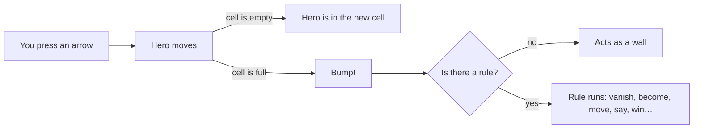
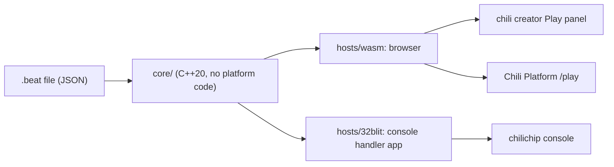

# Chili Beat

Chili Beat is a tiny game engine for the web and the
[chilichip console](https://github.com/chili-chip). You make games with
pictures and rule cards. There is no code to write.

The mechanics and graphics are kept very small on purpose. The same few pieces
can make a puzzle, a chase, a garden that grows, a story walk or a rhythm game.

!!! info "Status"
    Work in progress. The file format (v1) is written down. The engine is being
    built. See the [roadmap](roadmap.md).

## The six ideas

Everything in the engine comes from these six ideas. If a feature would need a
seventh idea, it does not go in.

| # | Idea | What it means |
|---|------|---------------|
| 1 | **One screen, one grid** | The screen is 128 × 128 pixels: a board of 16 × 16 cells, each 8 × 8 pixels. Counters are drawn over the board, in the top-left corner. |
| 2 | **Four colours** | Each game picks 4 colours from the [Sweetie 16](palette.md) palette. Colour 0 is the background. |
| 3 | **Everything is a thing** | Heroes, walls, coins, doors and enemies are all *things*. A cell holds at most one thing, on top of a ground picture. |
| 4 | **One verb: bump** | When a thing moves into a cell that is not empty, it *bumps* what is there. Rules decide what happens. With no rule, the thing acts as a wall. |
| 5 | **Time is a beat** | The world moves on a steady beat, 2 to 8 times a second, and the music plays on the same beat. Or switch to *turns*: the world moves only when you do. |
| 6 | **Rules are sentences** | "When Bee bumps Flower, Flower becomes Bud." You build rule cards from pictures. |

## Why bump

One mechanic covers a lot:

| You want | Bump rule |
|----------|-----------|
| A wall | No rule at all. |
| A pick-up | The bumped thing vanishes. The cell is free, so you move in. |
| A crate you push | The bumped thing moves the same way first. The cell is free, so you move in. |
| A door that needs a key | If Keys is at least 1, the door vanishes. |
| Someone to talk to | The bumped thing says something. |
| An enemy | When Wasp bumps Bee, you lose. |

You learn one idea, then combine it.

## A game in one picture

This is the Bee Home example. Seven rule cards make the whole game.

{ .pixel }

<b class="w">WHEN</b> you press an arrow <b class="t">THEN</b> you move that way
<b class="w">WHEN</b> Bee bumps Flower <b class="t">THEN</b> Flower becomes Bud · Pollen up 1 · play coin
<b class="w">WHEN</b> every 8 beats, Bud <b class="t">THEN</b> becomes Flower
<b class="w">WHEN</b> every 2 beats, Wasp <b class="t">THEN</b> moves toward you
<b class="w">WHEN</b> Wasp bumps Bee <b class="t">THEN</b> shake · you lose "Stung! Try again."
<b class="w">WHEN</b> Bee bumps Hive <b class="i">IF</b> Pollen at least 5 <b class="t">THEN</b> you win "The hive is happy."
<b class="w">WHEN</b> Bee bumps Hive <b class="i">IF</b> Pollen at most 4 <b class="t">THEN</b> say "Bring me 5 pollen."

The file is in [`tests/data/bee-home.beat`](https://github.com/chili-chip/chili-beat/blob/main/tests/data/bee-home.beat).
More in [Example games](examples.md).

## Where it runs

One C++ core runs everywhere, so a game plays the same in the creator, on the
platform and on the console.

## Limits

| Part | Limit |
|------|-------|
| Colours per game | 4 |
| Thing kinds | 64 |
| Screens | 64, on an 8 × 8 map |
| Counters | 4 |
| Rules | 128, with up to 2 conditions and 6 actions each |
| Blips (sound effects) | 16 |
| Tunes | 8, each 16 steps with 2 voices |
| Text in one say | 64 characters |

There are no saves in v1.
