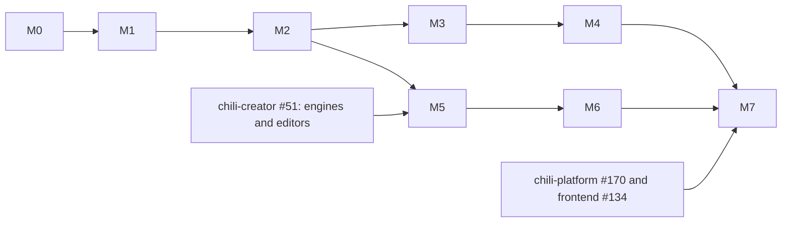

# Roadmap

The plan is tracked in [#1](https://github.com/chili-chip/chili-beat/issues/1).

| # | Milestone | Issue | Repo |
|---|-----------|-------|------|
| M0 | File format v1 and fixture games | [#2](https://github.com/chili-chip/chili-beat/issues/2) | chili-beat |
| M1 | Core engine: load, board, move, bump, render | [#3](https://github.com/chili-chip/chili-beat/issues/3) | chili-beat |
| M2 | Rules, counters, screens, text, win and lose | [#4](https://github.com/chili-chip/chili-beat/issues/4) | chili-beat |
| M3 | Sound: blips and tunes on the beat | [#5](https://github.com/chili-chip/chili-beat/issues/5) | chili-beat |
| M4 | Hosts: web (wasm) and console (handler .blit) | [#6](https://github.com/chili-chip/chili-beat/issues/6) | chili-beat |
| M5 | Creator editor: Things, Screens, Rules, Game, Play | [#7](https://github.com/chili-chip/chili-beat/issues/7) | chili-creator |
| M6 | Creator editor: Sounds, recipes, templates, checks | [#8](https://github.com/chili-chip/chili-beat/issues/8) | chili-creator |
| M7 | Ship on the platform and console | [#9](https://github.com/chili-chip/chili-beat/issues/9) | all |

Not in v1: saves, more than 4 colours, scrolling, physics, code.
